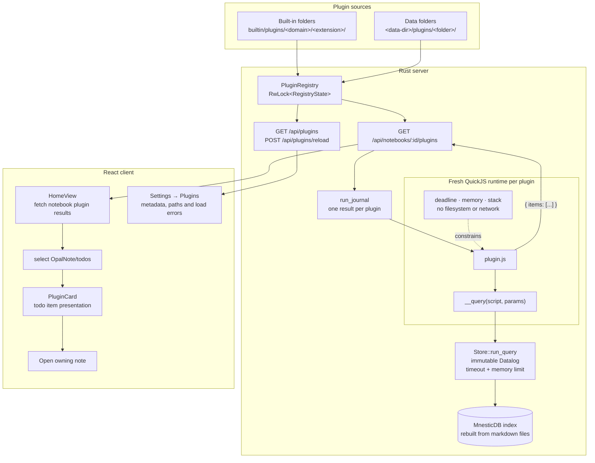

# OpalNote Plugin System Review

This document describes the current journal-plugin system: how plugins are
loaded, executed, exposed by the server, and rendered by the web client. It
also records the main limitations and possible directions for the next
iteration.

## Implementation status

The first two UI-expansion phases are implemented:

- plugin results may carry an optional `ui` descriptor
- Home renders every plugin result instead of selecting `OpalNote/todos`
- `PluginHost` supports safe renderer kinds, declarative schema nodes, and the
  legacy item card fallback
- the server validates schema nodes, actions, string sizes, depth, node count
  and payload size before returning them
- actions are limited to `openNote`, `openTag`, `openExternal`, and
  `runCommand`

The rest of this document describes the data pipeline; the schema contract is
summarized below in the UI section.

## 1. High-level model

OpalNote plugins are **server-side JavaScript widgets** backed by read-only
Datalog queries.

They are not:

- browser-side React extensions
- filesystem or network integrations
- markdown renderers
- event hooks or background workers

The current pipeline is:

```text
plugin folder
  plugin.json + plugin.js
          |
          v
PluginRegistry (loaded at startup / explicit reload)
          |
          v
GET /api/notebooks/{id}/plugins
          |
          v
QuickJS runtime per plugin
  - __notebook_id
  - __query(script, params) -> Datalog rows
          |
          v
JSON { items: [...] }
          |
          v
HomeView -> PluginCard
```

The server runs every registered plugin for the requested notebook and returns
one result per plugin. The client currently renders only the built-in
`OpalNote/todos` result.

## Overview diagram



## Built-in source and generation

Built-in plugin and background sources live under `builtin/src/`. Each package
has a `package.json`; plugins put the final manifest in `opal_note` and use
`opal_note_build` for the esbuild entry, target and minify setting.

`pnpm build:builtins` generates:

```text
builtin/plugins/<id>/plugin.json
builtin/plugins/<id>/plugin.js
builtin/backgrounds/<id>/background.json
builtin/backgrounds/<id>/<assets>
```

The generated directories are what Rust embeds (release) or reads from disk
(debug). `pnpm build:builtins:check` verifies that generated output is current.
The final `plugin.js` remains an IIFE expression returning a JSON string; only
the source package format and build step are new.

## 2. Loading the registry

### 2.1 Entry point

`src/main.rs` creates a `PluginRegistry` at startup:

```text
data_dir/plugins
```

The registry is stored in `AppState` and is shared by all requests.

### 2.2 Built-in plugins

Built-ins live under:

```text
builtin/plugins/<domain>/<extension>/plugin.json
builtin/plugins/<domain>/<extension>/plugin.js
```

Current built-in:

```text
builtin/plugins/OpalNote/todos
```

Loading differs by build:

- **Release build:** `rust-embed` embeds `builtin/plugins/`. The binary does not
  need the folder on disk.
- **Debug build:** files are read from `CARGO_MANIFEST_DIR/builtin/plugins`
  at runtime. The dev watcher restarts the server when this folder changes.

Built-in ids always win.

### 2.3 Data plugins

A user plugin is a folder under:

```text
<data-dir>/plugins/<folder>/
  plugin.json
  plugin.js
```

The folder name is not required to equal the manifest id, but the manifest id
must be unique. If a data plugin tries to reuse a built-in id, the data plugin
is rejected and a load error is recorded.

The data plugin directory is scanned:

- at server startup
- when `POST /api/plugins/reload` is called

It is not watched automatically.

### 2.4 Manifest

`plugin.json` fields:

| Field | Required | Limits |
|---|---|---|
| `id` | yes | `<domain>/<extension>`; max 96 chars |
| `title` | yes | 1-120 chars |
| `description` | yes | 1-500 chars |

The id must contain exactly one `/`. Both sides must start with an ASCII
alphanumeric character and may contain letters, digits, `-`, `_`, and `.`.

Examples:

```text
OpalNote/todos
Acme/my-widget
```

### 2.5 File limits and validation

- `plugin.json`: at most 16 KiB
- `plugin.js`: at most 20 KiB, must be UTF-8 and non-empty
- Invalid manifests/scripts become `PluginLoadError`s; they do not prevent other
  plugins from loading.
- Plugins are sorted by id in the registry.

### 2.6 Reload behavior

`PluginRegistry` holds:

```rust
RwLock<RegistryState>
```

`reload()` builds a new registry state and swaps it atomically. In-flight plugin
runs keep using the snapshot they started with.

## 3. Plugin execution

### 3.1 Endpoint

```text
GET /api/notebooks/{id}/plugins
```

The handler:

1. checks that the notebook exists
2. runs the work inside `routes::db_call` / `spawn_blocking`
3. calls `PluginRegistry::run_journal`
4. returns one `JournalPluginResult` per plugin

### 3.2 Fresh runtime per plugin

Every plugin execution creates a new QuickJS runtime and context with:

- 16 MiB memory limit
- 512 KiB stack limit
- a wall-clock deadline
- an interrupt handler that stops runaway JavaScript

The timeout comes from `plugin_timeout_secs`, clamped to 0.1-30 seconds. It is
applied per plugin, not across the whole plugin set.

### 3.3 Injected globals

Each script receives:

```js
__notebook_id;              // current notebook id
__query(script, params);    // read-only Datalog bridge
```

`__query` is a JavaScript wrapper around a native Rust host function. It parses
the host JSON response and returns the `rows` array.

### 3.4 Datalog bridge restrictions

The host function rejects:

- empty query scripts
- scripts longer than 20 KiB
- scripts containing `::` system commands

Parameters must be a JSON object with at most 100 entries. They are converted
to MnesticDB `DataValue`s and passed as bound parameters.

`Store::run_query` then runs the query with:

- `ScriptMutability::Immutable`
- a timeout derived from the remaining plugin deadline
- the query memory limit

There is no host API for:

- file reads or writes
- network access
- mutation queries
- process execution
- timers or async JavaScript

### 3.5 Script contract

`plugin.js` is evaluated as a JavaScript expression. In practice it must be an
IIFE or another expression that returns a JSON string, for example:

```js
(function () {
  const rows = __query(`
    ?[note_path, line, text, status] :=
        *task{notebook_id, note_path, line, text, status},
        notebook_id = $notebook_id,
        status != "done"
  `, { notebook_id: __notebook_id });

  return JSON.stringify({
    items: rows.map(function (row) {
      return {
        id: String(row[0]) + ":" + String(row[1]),
        title: String(row[2]),
        detail: String(row[0]),
        note_path: String(row[0]),
        line: Number(row[1]),
        status: String(row[3])
      };
    })
  });
})()
```

The server accepts:

```json
{ "items": [ ... ] }
```

or a bare array. The result must be an array; it is truncated to 200 items.

If a plugin throws, returns invalid JSON, or times out, the error is returned in
that plugin's `JournalPluginResult.error` field with empty items. Other plugins
still run.

## 4. Built-in todos plugin

`builtin/plugins/OpalNote/todos/plugin.js`:

- queries the `*task` relation joined with `*note`
- filters `status != "done"` and `status != "cancelled"`
- orders by `-updated_at`
- limits to 100 tasks
- maps rows into the client item shape:

```ts
{
  id: string;
  title: string;
  detail: string;
  note_path: string;
  line: number;
  status: string;
  updated_at?: number;
}
```

`title` is cleaned markdown task text; `detail` is the owning note title.

## 5. Server API surface

### Plugin metadata

```text
GET /api/plugins
POST /api/plugins/reload
```

Returns:

```ts
{
  directory: string;
  plugins: Array<{
    id: string;
    title: string;
    description: string;
    source: "builtin" | "data";
    path?: string;
  }>;
  errors: Array<{
    folder: string;
    message: string;
  }>;
}
```

### Notebook plugin results

```text
GET /api/notebooks/{id}/plugins
```

Returns:

```ts
Array<{
  id: string;
  title: string;
  description: string;
  items: JournalPluginItem[];
  error?: string;
}>
```

The server type uses generic `serde_json::Value` items, but the web client types
them as `JournalPluginItem[]`.

## 6. Client rendering

### 6.1 Settings -> Plugins

The Settings dialog has a Plugins tab that:

- loads `GET /api/plugins`
- displays metadata for every registered plugin
- shows built-in/data source and manifest path
- shows load errors
- calls `POST /api/plugins/reload`
- bumps `journalPluginsRevisionAtom` after reload

This is the only place where all plugin metadata is displayed. It does not
render plugin items.

### 6.2 Home view

`HomeView` fetches plugin results in an effect:

```ts
api.journalPlugins(notebookId)
```

Dependencies:

- `notebookId`
- `notesRevisionAtom`
- `journalPluginsRevisionAtom`

It then selects exactly one result:

```ts
plugins.find((plugin) => plugin.id === "OpalNote/todos")
```

So other plugins are executed and returned, but are ignored by the current UI.

The selected result is rendered in the Home right strip under
**Outstanding todos** using `PluginCard`.

### 6.3 PluginCard

`PluginCard` owns the presentation, not the plugin.

It renders:

- plugin title
- item count
- plugin error, if any
- an “All clear.” empty state
- one button per item

Each item button:

- shows a checkbox-like status square
- shows `item.title`
- shows `item.detail` (`note_path` formatted as a journal date when it starts
  with `journals/`)
- appends `· doing` when `status === "doing"`
- opens the owning note via `navigate({ view: "note", noteId: item.note_path })`

### 6.3.1 Declarative UI schema

A plugin can return `ui.schema: 1` with a `root` node. The supported nodes are:

```text
card, section, row, heading, text, badge, list,
button, link, separator, empty, markdown, graph
```

`markdown` renders a read-only instance of the app's live markdown editor using
the current notebook. `graph` renders the notebook graph and accepts optional
`scope` (`local`/`all`), `includeTags`, and `height` (120-480) fields.

The supported actions are:

```text
openNote, openTag, openExternal, runCommand
```

`PluginHost` renders the tree through `PluginNodeView`; unknown node types are
ignored. The server enforces:

- at most 64 KiB UI JSON
- at most 8 nesting levels
- at most 200 nodes/items
- at most 200 characters per string
- allowed action types and safe external URL schemes

The built-in todos plugin now returns a schema card/list instead of relying on
the hard-coded Home selection.

### 6.4 Refresh path

`JournalCard` calls `refreshJournalPluginsAtom` after journal-card saves. The
Home todos effect then reruns.

Settings reload also bumps `journalPluginsRevisionAtom`.

Structural or metadata note refreshes can rerun the effect through
`notesRevisionAtom`. Ordinary body-only note saves no longer bump that atom.

### 6.5 Important coupling

The renderer is currently todo-specific even though the server contract is
generic:

- `HomeView` hard-codes `OpalNote/todos`.
- `PluginCard` expects `note_path`, `detail`, `status`, `line`, and `updated_at`.
- The checkbox, journal-date formatting, “doing” label, and “All clear.” state
  are all fixed todo presentation.
- No plugin-provided renderer, schema, or item template exists.
- No plugin rail exists in the journal feed; plugin results are only rendered
  on Home.

## 7. Security posture

The current sandbox is intentionally small:

- fresh QuickJS runtime per plugin
- memory/stack limits
- per-plugin wall-clock interrupt
- read-only Datalog only
- no filesystem or network host APIs
- parameterized queries only
- system commands rejected
- result size bounded

This protects the server from untrusted plugin JavaScript reasonably well for a
single-user, self-hosted app. It is not a multi-tenant isolation boundary.

## 8. Review findings and limitations

### Functional

1. **Only todos are rendered.** Additional plugins are loaded and executed but
   have no visible result unless the client is changed to consume them.
2. **No generic plugin renderer.** The server returns generic `{ items }`, but
   the client assumes the todo item schema.
3. **No plugin enable/disable or configuration.** All registered plugins run on
   every notebook plugin request.
4. **No plugin assets.** A plugin is only manifest + JS; there is no declared
   icon, stylesheet, or UI schema.
5. **No plugin-level notebook scoping.** A plugin can query any notebook data
   through Datalog; the UI only runs it for the selected notebook, but the
   script receives the notebook id and can query beyond it if it wants.
6. **No caching.** Home remounts or revision bumps rerun every plugin. The
   endpoint runs plugins sequentially, so total latency is roughly the sum of
   all plugin times.

### Developer experience

1. `plugin.js` is not wrapped by the server; a top-level `return` is invalid.
   The documented form is an IIFE.
2. `__query` returns rows only, with no column names or type metadata.
3. There is no local plugin development watcher; data plugin changes require
   Settings -> Reload, while built-in changes restart the dev server.
4. Errors are per plugin and surfaced in the UI, but the plugin author has no
   structured diagnostics beyond the exception string.
5. The data plugin folder name and manifest id can differ, which is flexible but
   can make load errors harder to trace.

### Server/API

1. `JournalPluginResult.items` is generic JSON on the server, but the client
   assumes `JournalPluginItem[]` with no runtime validation.
2. Plugin metadata does not include capabilities, schema, version, or renderer
   hints.
3. There is no per-plugin timeout override; all plugins share the global
   `plugin_timeout_secs`.
4. Plugin execution has no parallelization or cache.

## 9. Suggested next steps

If the plugin system is expanded, the highest-value changes are:

1. **Define an item schema** shared by server and client, with runtime
   validation on the client.
2. **Add a generic plugin section renderer** on Home, or allow a plugin to
   declare a renderer kind (`todos`, `list`, `links`, etc.).
3. **Stop hard-coding `OpalNote/todos`** in `HomeView`; render each plugin result
   or let the notebook choose which plugins appear.
4. **Add plugin enable/disable and optional settings** so unused plugins do not
   run.
5. **Cache plugin results** per notebook and invalidate on relevant note/task
   changes.
6. **Add a plugin local-development flow** (reload on data folder change or a
   per-plugin reload action).
7. **Expose query column metadata** to plugin authors, or provide a typed helper
   for common relations such as `task`.
8. **Add plugin assets/metadata** if custom icons or documentation are needed.

These changes can be made incrementally without changing the current QuickJS
execution model.

## 10. Key files

```text
src/plugins.rs                     registry, loader, QuickJS runner, Datalog bridge
src/routes/plugins.rs              API handlers
src/state.rs                       PluginRegistry in AppState
src/main.rs                        registry startup
src/config.rs                      plugin_timeout_secs / env / CLI
builtin/plugins/OpalNote/todos/    built-in todos plugin
web/src/api/client.ts              journalPlugins / listPlugins / reloadPlugins
web/src/api/types.ts               plugin response types
web/src/state/atoms.ts             journalPluginsRevisionAtom
web/src/components/HomeView.tsx    plugin fetch and todo strip
web/src/components/PluginCard.tsx  todo-specific item renderer
web/src/components/SettingsDialog.tsx  plugin list and reload UI
```
